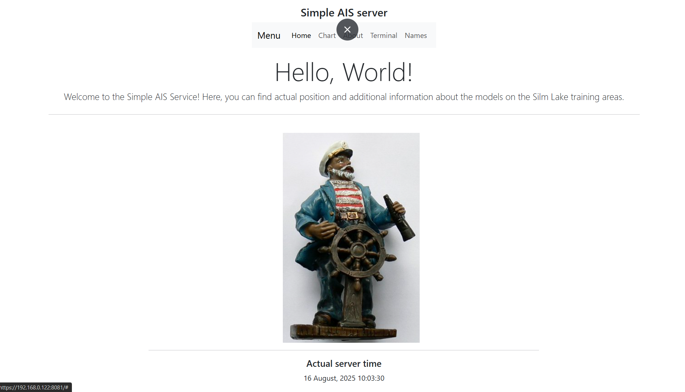
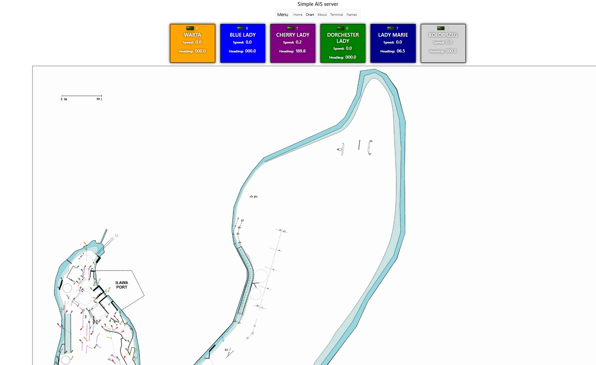
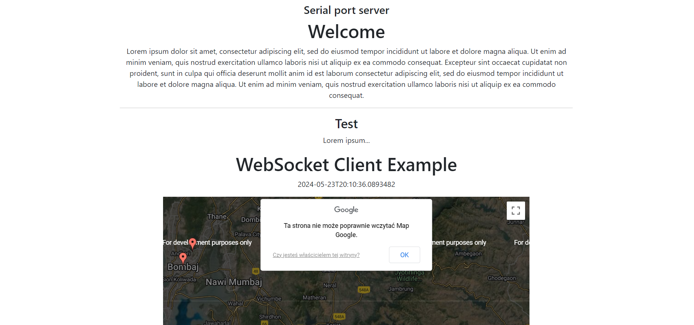

# Serial Protocol – Simple AIS

Aplikacja Spring Boot (Java 25) do odbioru i wizualizacji danych AIS z portów szeregowych (RS-232) w czasie rzeczywistym przez WebSocket.

## Wymagania

- Java 25+
- Maven 3.9+ (lub wrapper `mvnw` / `mvnw.cmd`)
- MariaDB 11.7 (lub Docker)

## Szybki start

### Docker (zalecane)

```bash
./start_docker.sh        # uruchomienie w pierwszym planie
./start_docker.sh -d     # uruchomienie w tle
./stop_docker.sh         # zatrzymanie
```

`start_docker.sh` wymaga zbudowanego `target/serial-protocol-<wersja>.jar` i `cert/server.p12`. Najpierw buduje obraz, a stack zatrzymuje dopiero po udanym buildzie. Kontenera MariaDB nie odtwarza.

> **Uwaga:** nie uruchamiaj `start_docker.sh` na serwerze wdrażanym przez `deploy/deploy.sh`, bo w tamtym folderze nie ma `Dockerfile` ani JAR-a. Skrypt odmówi działania. Szczegóły w [`deploy/README.md`](deploy/README.md).

Docker Compose podnosi dwa kontenery:
- **serial-ports-server** – aplikacja (port `8081` → `443` wewnątrz kontenera)
- **mariadb** – baza danych MariaDB 11.7

### Lokalnie z Maven

```bash
.\mvnw.cmd spring-boot:run
```

### Z pliku JAR

```bash
.\mvnw.cmd clean package -Dmaven.test.skip=true
java -jar .\target\serial-protocol-3.0.jar
```

Aplikacja nasłuchuje na porcie **443** (HTTPS, SSL/PKCS12).
W przeglądarce: `https://localhost:8081/` (przez Docker) lub `https://localhost:443/` (lokalnie).

### Przekierowanie HTTP → HTTPS

Gdy `server.http.redirect.enabled=true`, aplikacja uruchamia dodatkowe konektory HTTP, które przekierowują cały ruch na port HTTPS (`server.port`).

| Właściwość | Domyślnie | Opis |
|---|---|---|
| `server.http.redirect.enabled` | `true` | Włącza przekierowanie HTTP → HTTPS |
| `server.port` | `443` | Port HTTPS (cel przekierowania) |
| `server.http.ports` | `80,8080` | Lista portów HTTP nasłuchujących i przekierowujących na `server.port` |

- Przekierowanie działa **tylko** dla ruchu trafiającego na skonfigurowane porty HTTP (np. `http://host:80`, `http://host:8080`). Inne porty nie są nasłuchiwane → połączenie odrzucone.
- Porty w `server.http.ports` muszą być unikalne i różne od `server.port`; w przeciwnym razie aplikacja zgłosi `IllegalStateException` przy starcie (walidacja w `TomcatServerConfiguration`).
- Odpowiedzi HTTPS zawierają nagłówek `Strict-Transport-Security` (HSTS: `max-age=31536000; includeSubDomains; preload`) konfigurowany w `SecurityConfig`.

## Budowanie i testy

| Polecenie | Opis |
|---|---|
| `.\mvnw.cmd clean test` | Pełny zestaw testów |
| `.\mvnw.cmd -Dtest=MapControllerTest test` | Pojedyncza klasa testowa |
| `.\mvnw.cmd -Dtest=MapControllerTest#test_IndexEndpoint test` | Pojedyncza metoda testowa |
| `.\mvnw.cmd clean package` | Budowa JAR z testami |
| `.\mvnw.cmd clean package -Dmaven.test.skip=true` | Budowa JAR bez testów |

## Konfiguracja transmisji szeregowej

Koniec wiadomości w transmisji szeregowej jest rozpoznawany przez pojawienie się znaków ustawianych we właściwości:
```
rs.message_delimiter=13,10
```
Taka wiadomość pojawia się w logach konsoli, zostaje zapisana w plikach logów oraz wyświetlona na stronie WWW w czasie rzeczywistym.

## Architektura

### Pipeline odbioru danych
`SerialController` → `SerialPortListenerImpl` → `FrameIngress` → `MessageTranslator` → WebSocket (`/rs`, `/json`)

Serwer UDP (`UdpServer` → `UdpPacketHandlerImpl`) wchodzi do tego samego `FrameIngress`, więc datagram jest traktowany dokładnie jak ramka z portu szeregowego.

### Symulator danych (bez modeli)
Katalog `simulator/` zawiera osobną aplikację `ship-sim`, która karmi serwer ramkami przez UDP (port 2222). Odtworzenie nagrania z sześcioma statkami: `run-sim.bat replay --from docs\LogTerminal.txt --loop` (wymaga JDK 25; kartę `/chart` trzymaj na wierzchu). Szczegóły: [`simulator/README.md`](simulator/README.md), plan i decyzje: [`docs/e2e-simulator-plan.md`](docs/e2e-simulator-plan.md).

### Kanały WebSocket
| Kanał | Opis |
|---|---|
| `/rs` | Surowe dane z portu szeregowego |
| `/json` | Przetłumaczone dane jako JSON (`ModelTrackDTO`) |
| `/heartbeat` | Sygnał heartbeat |
| `/session` | Licznik aktywnych sesji |

### Modele statków
| Model | ID |
|---|---|
| WARTA | 1 |
| BLUE_LADY | 2 |
| DORCHERTER_LADY | 3 |
| CHERRY_LADY | 4 |
| KOLOBRZEG | 5 |
| LADY_MARIE | 6 |

### Generowanie raportów PDF
Aplikacja umożliwia generowanie raportów PDF z danych kursów (`PdfReportController` → `PdfReportService`). Konfiguracja czcionek i limitów w `application.properties` (prefiks `pdf.report.*`).

### Bezpieczeństwo
Użytkownicy są w tabeli `app_user` (hasła jako hashe `{bcrypt}`). Przy pierwszym starcie, gdy tabela nigdy nie miała wierszy, aplikacja zakłada konta `user` i `admin` z właściwości `custom.server.credentials.*` (zmienne `SERVER_USER`, `SERVER_PASSWORD`, `SERVER_ADMIN_USER`, `SERVER_ADMIN_PASSWORD`); później te zmienne niczego już nie zmieniają. Chronione ścieżki: `/name-service/**`, `/instructor-service/**`, `/api/**`, `/admin/**`, `/pdf/**`, `/tracks/**`, oraz wszystkie endpointy CRUD domeny custom (`/trainer-service/**`, `/lecturer-service/**`, `/technician-service/**`, `/participant-service/**`, `/courses-service/**`, `/course-type-service/**`, `/course-counter-service/**`). Role: jedna na konto (`OPERATOR`, `USER`, `ADMIN`; ADMIN obejmuje USER, USER obejmuje OPERATOR). Operator widzi tylko podgląd tras (`GET /tracks`, `/tracks/api/**`, bez drukowania PDF); resztę chronionych ścieżek otwiera dopiero USER, a `/admin/**` ADMIN. Rolę ustawia administrator w `/admin/users`.

Konta założone przy pierwszym starcie (`user`, `admin`) mają ustawioną flagę wymuszenia zmiany hasła: po pierwszym logowaniu użytkownik jest kierowany na `/account/password` i do czasu zmiany hasła nie wejdzie nigdzie indziej (dotyczy też klientów API z Basic auth, którzy dostają 403, a po zmianie muszą używać nowego hasła). Administrator zarządza użytkownikami pod `/admin/users` (dodawanie, ustawianie roli Operator / User / Admin, wyłączanie, reset hasła; wyłączenie, zmiana roli i reset kończą sesje danego użytkownika), a każdy użytkownik zmienia własne hasło pod `/account/password` (min. 12 znaków, maks. 72 bajty UTF-8). Dla automatyzacji utwórz osobnego użytkownika, zmień jego hasło tymczasowe i dopiero potem skonfiguruj klienta.

## Dokumentacja szczegółowa

Katalog [`docs/`](docs/) zawiera dodatkowe materiały opisujące implementację i środowisko:

| Dokument | Opis |
|---|---|
| [`chart-map-view.md`](docs/chart-map-view.md) | Implementacja interaktywnej mapy (`/chart`) – architektura warstw Konva, formaty obrazu mapy (AVIF/WebP/JPG), zoom/pan/pinch, kalibracja pozycji statków, optymalizacje transferu HTTP, wersje bibliotek |
| [`custom-domain-analysis.md`](docs/custom-domain-analysis.md) | Pełna analiza domenowa modułu `custom` – hierarchia encji (`PersonBase`, `Lecturer`, `Trainer`, `Technician`, `Participant`, `Courses`, `CourseType`, `CourseCounter`, `Image`), mapowanie DTO, szablony Thymeleaf, lista naprawionych bugów i ostrzeżeń |
| [`pdf-report-plan.md`](docs/pdf-report-plan.md) | Plan implementacji raportów PDF – porównanie bibliotek (OpenPDF, iText, PDFBox, Openhtmltopdf), architektura rozwiązania, API endpointów `/pdf/**`, layout i kolorystyka raportów |
| [`Opis RS232.txt`](docs/Opis%20RS232.txt) | Przykładowe logi z transmisji szeregowej – format ramek, odkrywanie portów na Linux (Futro 720) i Windows 10, zdarzenia `serialEvent` |
| [`js.navigator.userAgent.txt`](docs/js.navigator.userAgent.txt) | Referencja User-Agent dla testowanych urządzeń i przeglądarek (Chrome, Edge, Safari, Samsung Internet na Windows, Android, iPhone, iPad) |

Dodatkowo w `docs/` znajdują się zrzuty ekranu interfejsu aplikacji (`img.png`, `img_1.png`, `img_2.png`, `img_3.png`).

## Zrzuty ekranu





